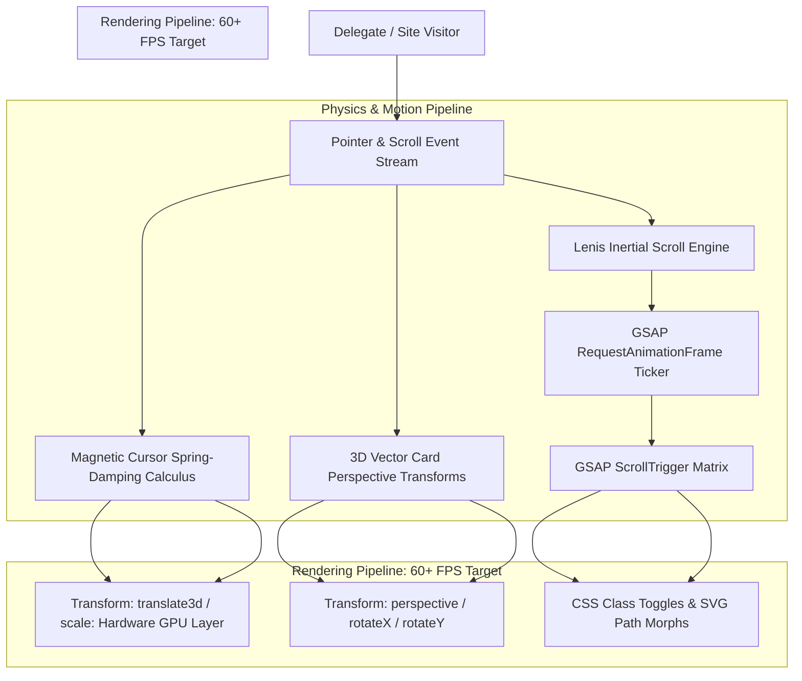

# SCINNOVA IX — Official Web Platform & Digital Experience

> **Category:** Official Olympiad Web Experience, Frontend Engineering & Motion Design  
> **Institutional Context:** SCINNOVA IX (Flagship National Science & Innovation Olympiad)  
> **Frontend Engine:** 1,036 Lines of Hand-Crafted Vanilla JavaScript (ES6+) | CSS3 Architecture  
> **Animation & Physics:** GSAP 3.12 (ScrollTrigger, TextPlugin) | Studio Freight Lenis Inertial Engine  
> **Interaction Dynamics:** Real-Time Mathematical Spring Physics, 3D Vector Tilts & Magnetic Cursors  
> **Honorary Award:** Awarded **Honorary Shield of Excellence** on Stage by Patron Sir Rayyan Dawood  
> **Author & Creator:** Muhammad Rayyan Kashif (100% Solo Design, Physics & Engineering)  

---

## 1. Project Overview & Institutional Context

**SCINNOVA IX** is one of the country’s premier inter-school and collegiate science, robotics, and innovation olympiads, hosting hundreds of competing delegates across competitive categories including applied engineering, theoretical physics, biological forensics, computational mathematics, and speculative design.

To represent the forward-looking, high-caliber nature of the olympiad, the digital portal needed to move beyond static school websites into an immersive, mathematically driven creative web experience. Engineered completely from scratch without monolithic UI frameworks, the **SCINNOVA IX Web Experience** blends smooth inertial scrolling, custom mathematical spring cursor physics, real-time 3D perspective transformations, and multi-tier timeline interactions. The platform registered hundreds of delegate teams nationwide and earned the **Honorary Shield** presented on stage by Patron Sir Rayyan Dawood.

---

## 2. Problem Statement & Core Purpose

* **Performance Traps of Modern Heavy Frameworks:** Bloated JavaScript bundles frequently introduce frame drops below 60 FPS, ruining scroll smoothness and interactive responsiveness on student laptops and mobile devices.
* **Lack of Visceral Engagement:** Conventional school event landing pages rely on static text and raster imagery, failing to communicate the intellectual rigor and technological excitement of a competitive science olympiad.
* **Mathematical Cursor & Tilt Coordination:** Delivering real-time mouse-tracking magnetic effects, spring-damping follower rings, and 3D card tilt without accumulating browser layout thrashing requires precise frame-budget management.
* **Complex Multi-Category Module Navigation:** Delegates need to seamlessly explore diverse competition categories, rules, and scoring rubrics without disorienting page reloads.

---

## 3. System Architecture & Engineering Design

The platform’s runtime architecture prioritizes zero-overhead DOM manipulation, decoupled animation tickers, and hardware-accelerated CSS GPU layers:

### Architectural Pillars:
* **Zero-Framework Vanilla JavaScript:** Authored across 1,036 lines of clean, modular ES6+ JavaScript, eliminating unnecessary runtime virtual DOM overhead and achieving instantaneous Time-to-Interactive (TTI).
* **Synchronized Animation Loop:** Tied Studio Freight Lenis smooth scrolling into the GSAP ticker loop, ensuring that all scroll-bound parallax transformations render within the exact same `requestAnimationFrame` lifecycle.
* **Hardware-Accelerated Compositing:** Constrains all continuous motion to `transform: translate3d()` and `opacity`, bypassing browser layout calculation and paint cycles to preserve a rock-solid 60+ FPS.

---

## 4. Key Engineering Implementations

### A. Fluid Magnetic Cursor with Spring Physics
To create an intuitive, tactile connection between the user’s cursor and interactive interface nodes:
* Built a dual-element cursor system featuring an instant center focal dot and a delayed, fluidly lagging outer tracking ring.
* Detects fine pointer media queries (`pointer: fine`) to disable tracking automatically on touch displays.
* Implemented spring-damping interpolation math:
  $$\mathbf{P}_{\text{follower}}(t + \Delta t) = \mathbf{P}_{\text{follower}}(t) + \lambda \cdot (\mathbf{P}_{\text{cursor}}(t) - \mathbf{P}_{\text{follower}}(t))$$
* When hovering over interactive buttons or competition module cards, the outer ring dynamically morphs its radius, adjusts its border thickness, and applies a magnetic attraction vector drawing the button slightly toward the pointer center.

### B. Studio Freight Lenis Inertial Scrolling Engine
Eliminates abrupt browser wheel stutter with an exponential decay easing curve:
* Initialized Lenis with custom friction constants:
  $$s(t) = \min\left(1, \, 1.001 - 2^{-10t}\right)$$
* Synchronized scroll updates with `ScrollTrigger.update`, allowing complex multi-stage section pinning, horizontal rule reveals, and SVG line-drawing animations to execute without visual tearing.

### C. 3D Perspective Vector Tilt on Competition Cards
To give competition module cards depth without WebGL overhead:
* Calculated relative normalized pointer coordinates $(x_{\text{norm}}, y_{\text{norm}}) \in [-0.5, 0.5]$ upon mouse movement over card boundaries:
  $$x_{\text{norm}} = \frac{x_{\text{mouse}} - x_{\text{center}}}{w_{\text{card}}}, \quad y_{\text{norm}} = \frac{y_{\text{mouse}} - y_{\text{center}}}{h_{\text{card}}}$$
* Injected rotation transformations directly into element style matrices:
  $$\text{rotateY} = x_{\text{norm}} \times \theta_{\max}, \quad \text{rotateX} = -y_{\text{norm}} \times \theta_{\max}$$
* Accompanied by a dynamic specular lighting glare layer that shifts across the card surface in the direction of the virtual light source.

### D. Multi-Stage Interactive Competition Module Matrix
* Organized over a dozen interdisciplinary science events into interactive categorical views.
* Users can filter modules by difficulty, team size, and academic category (e.g., Robotics, Chemistry Olympiad, Bio-Forensics, Cryptographic Codebreaking).
* Clicking a module triggers an animated modal drawer displaying detailed event guidelines, scoring rubrics, and equipment prerequisites without page redirection.

### E. Schedule & Interactive Timeline Dynamics
* Built a synchronized event itinerary tracker organizing multi-day competition rounds and keynote sessions.
* Features responsive viewport adjustments and animated state reveals triggered on scroll thresholds without reflow thrashing.

---

## 5. Technical Stack & Specifications

* **Core Engine:** Hand-Crafted Vanilla JavaScript (ES6+, 1,036 lines)
* **Styling & Layout:** Pure CSS3 (49 KB, CSS Variables, Flexbox, CSS Grid, 3D Transforms)
* **Animation Suite:** GreenSock Animation Platform (GSAP 3.12, ScrollTrigger, TextPlugin)
* **Smooth Inertial Scrolling:** Studio Freight Lenis Scroll Engine
* **Design Assets:** Custom Vector Glyphs, Lucide Icons, Hardware-Accelerated Fonts

---

## 6. Author Role & Scope of Ownership

* **Scope:** **100% Solo Engineering, Physics Design & Creative Direction**.
* **Individual Ownership:**
  - Wrote 100% of the 1,036 lines of JavaScript and 49 KB of CSS styling.
  - Implemented the magnetic cursor physics, 3D perspective card calculations, and Lenis smooth scrolling integration.
  - Designed the comprehensive competition module catalog, schedule matrix, and interactive delegate registration workflows.
  - Recognized for technical leadership with an **Honorary Shield of Excellence** presented on stage by Patron Sir Rayyan Dawood.
