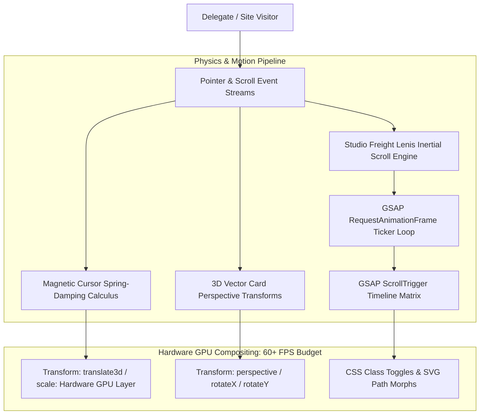

<div align="center">

# ⚡ SCINNOVA IX

**Official Website for SCINNOVA IX (Cedar College)**

[](https://developer.mozilla.org/en-US/docs/Web/JavaScript)
[](https://greensock.com/gsap/)
[](https://lenis.darkroom.engineering/)
[](https://www.w3.org/Style/CSS/)
[](https://muhammadrayyankashif.github.io/SCINNOVA-IX/)
[](https://opensource.org/licenses/MIT)

<p align="center">
  <em>The official website for <b>SCINNOVA IX</b>, the flagship inter-school science and innovation olympiad hosted at <b>Cedar College</b>.</em>
</p>

> 🌐 **Live Interactive Experience:** [https://muhammadrayyankashif.github.io/SCINNOVA-IX/](https://muhammadrayyankashif.github.io/SCINNOVA-IX/)

[Live Experience](https://muhammadrayyankashif.github.io/SCINNOVA-IX/) •
[Engineering Philosophy](#-1-engineering-philosophy--institutional-origin) •
[Motion Architecture](#-2-runtime-physics--motion-architecture) •
[Mathematical Implementations](#-3-key-mathematical--engineering-implementations) •
[Olympiad Modules](#-4-competition-modules--event-matrix) •
[Local Quickstart](#-5-local-quickstart) •
[Deep Technical Specs (Detail.md)](./Detail.md)

</div>

---

## 🏛️ 1. Engineering Philosophy & Institutional Origin

**SCINNOVA IX** is one of the country’s premier inter-school and collegiate STEM olympiads, uniting hundreds of competing delegates across competitive categories including applied engineering, theoretical physics, biological forensics, computational mathematics, and speculative design.

To capture the intellectual rigor and technological prestige of the competition, the digital portal needed to abandon static website paradigms in favor of an **immersive, mathematically simulated creative web experience**. 

Rejecting bloated single-page application (SPA) frameworks that introduce virtual DOM reconciliation overhead and frame drops, the platform was **hand-crafted from first principles in 100% Vanilla JavaScript (ES6+) and hardware-accelerated CSS3**.

> **Sole Creator & Lead Architect:** Muhammad Rayyan Kashif  
> **Institutional Context:** Cedar College (Karachi, Pakistan) — *Class Rank: 1 / 549, 4.00 Cumulative GPA, Cedar Scholar Award*  
> **Honorary Distinction:** Awarded the **Honorary Shield of Excellence** on stage by Patron Sir Rayyan Dawood in recognition of solo technological direction.  
> **Release Edition:** Official January 6, 2026 Pre-Event Launch Edition.  

---

## 📐 2. Runtime Physics & Motion Architecture

The application is structured around a synchronized animation pipeline where user pointer and scroll streams feed directly into physics calculation loops and GPU compositing layers:



### Architectural Pillars:
1. **Zero-Framework Vanilla JS:** Written in pure, modular ES6+ JavaScript, eliminating runtime virtual DOM diffing and achieving instant Time-to-Interactive (TTI).
2. **Unified RAF Loop:** Studio Freight Lenis smooth scrolling hooks directly into the GSAP ticker loop (`window.lenis.raf(time * 1000)`), guaranteeing that all scroll-bound parallax transformations render in the exact same `requestAnimationFrame` lifecycle without frame jitter.
3. **GPU Layer Promotion:** Constrains continuous animations strictly to `transform: translate3d()` and `opacity`, bypassing browser layout calculation and repaint cycles directly to GPU compositing buffers.

---

## ⚡ 3. Key Mathematical & Engineering Implementations

### A. Magnetic Cursor Calculus & Dynamic Spring Damping
To create a tactile, visceral connection between user pointer movements and interactive interface nodes:
* Implemented a dual-element cursor architecture composed of an instantaneous center focal dot and a delayed outer follower ring.
* Detects pointer precision via media queries (`pointer: fine`) to disable tracking on touchscreen devices automatically.
* Computes real-time spring-damping interpolation math:
  $$\mathbf{P}_{\text{follower}}(t + \Delta t) = \mathbf{P}_{\text{follower}}(t) + \lambda \cdot (\mathbf{P}_{\text{cursor}}(t) - \mathbf{P}_{\text{follower}}(t))$$
  *where $\lambda$ is the dynamic spring stiffness factor.*
* When hovering over navigation anchors, registration buttons, or competition cards, the outer ring morphs its radius, adjusts its border thickness, and applies a magnetic attraction field drawing the button toward the pointer epicenter.

### B. 3D Perspective Vector Card Tilt
Competition module cards render spatial depth through dynamic 3D transformations:
* Captures real-time mousemove coordinates relative to the card's bounding rect:
  $$x_{\text{norm}} = \frac{x_{\text{mouse}} - x_{\text{center}}}{w_{\text{card}}}, \quad y_{\text{norm}} = \frac{y_{\text{mouse}} - y_{\text{center}}}{h_{\text{card}}} \quad \in [-0.5, 0.5]$$
* Injects rotation matrices directly into the element's CSS transform properties:
  $$\text{rotateY} = x_{\text{norm}} \times \theta_{\max}, \quad \text{rotateX} = -y_{\text{norm}} \times \theta_{\max}$$
* Coupled with a dynamic radial specular glare layer that shifts across the card surface in the direction of the virtual light source.

### C. Studio Freight Lenis Inertial Scrolling Engine
Eliminates jarring native browser mousewheel stutter with an exponential decay easing curve:
* Configured Lenis with custom friction constants:
  $$s(t) = \min\left(1, \, 1.001 - 2^{-10t}\right)$$
* Synchronized scroll updates with `ScrollTrigger.update`, allowing multi-stage section pinning, horizontal rule reveals, and SVG path-drawing animations to execute without visual tearing.

### D. Audio Atmosphere & Sound Dynamics
* Engineered an interactive web audio layer with lightweight synthesized audio elements (`Fireworks.mp3`, `clock-tick.mp3`, `paper-flip.mp3`).
* Tied audio triggers to user micro-interactions (modal opens, button hovers, schedule inspection), reinforcing the tactile realism of the platform.

---

## 🎯 4. Competition Modules & Event Matrix

The portal categorizes over a dozen interdisciplinary STEM competitions into interactive modal drawers with downloadable study guides and rulebooks:

| Module Name | Academic Discipline | Description & Challenge Scope |
|---|---|---|
| **Planck's Paradox** | Theoretical Physics | Quantum mechanics, wave-particle duality, and relativity paradoxes. |
| **Automaton** | Robotics & Computer Science | Algorithmic logic, hardware circuits, and autonomous robotics design. |
| **Asclepius** | Forensic Medicine & Biology | Medical forensics, genetic pathology, and histological diagnoses. |
| **Freud's Forsit** | Behavioral Psychology | Cognitive biases, psychological profiling, and neuro-ethics. |
| **Illuminatio** | Astronomy & Astrophysics | Stellar evolution, cosmological redshift, and orbital celestial mechanics. |
| **Qwerty** | Applied Cryptography | Cipher decryption, stenography, and algorithmic codebreaking. |
| **Arcanum** | Applied Chemistry | Spectrophotometry, organic synthesis pathways, and stoichiometry. |

---

## 🚀 5. Local Quickstart

Because SCINNOVA IX is built on pure, uncompiled web technologies, it requires **zero build steps or package managers**:

1. **Clone the repository:**
   ```bash
   git clone https://github.com/muhammadrayyankashif/SCINNOVA-IX.git
   cd SCINNOVA-IX
   ```

2. **Serve locally using any HTTP server:**
   ```bash
   # Using Python 3:
   python3 -m http.server 3000

   # Or using Node.js:
   npx serve .
   ```

3. Open [http://localhost:3000](http://localhost:3000) in your browser.

---

## 📖 6. Comprehensive Engineering Specification

For an in-depth review of the underlying DOM architecture, frame-budget math, and event lifecycle design, view the dedicated specification:

👉 **[View the In-Depth Engineering Specification (Detail.md)](./Detail.md)**

---

## 📄 7. Authorship & License

* **Lead Architect & Developer:** **Muhammad Rayyan Kashif** (Cedar College, Class of 2027)
* **Scope:** 100% Solo Engineering, Physics Simulation & Creative Direction
* **License:** Distributed under the [MIT License](https://opensource.org/licenses/MIT).
